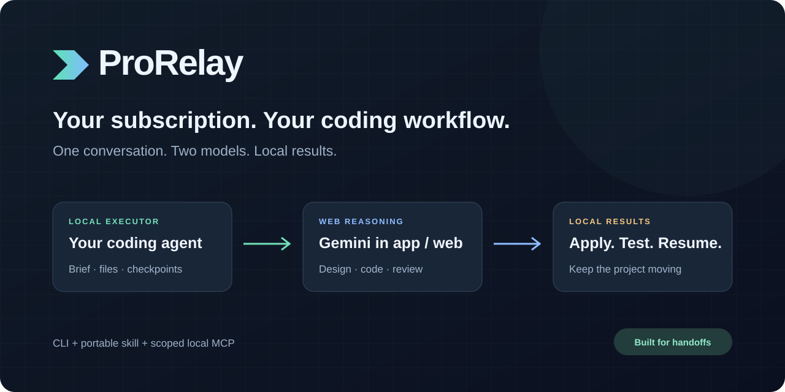
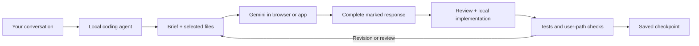

<p align="center"></p>

<p align="center">
  <a href="https://github.com/yanuarihsanxz-tech/prorelay/actions/workflows/check.yml"></a>
  
  
  
</p>

# ProRelay

**Already have Gemini Pro? Let your coding agent handle the handoff.**

Talk to your local coding agent. It turns the conversation into a brief, shares selected context with Gemini through an available browser or app, collects the answer, and continues implementation and testing in your project.

ProRelay connects those steps with durable task state and a portable agent skill. An optional local MCP bridge also lets compatible LLM clients read a chosen project folder, with writes available by explicit opt-in.

**One conversation. Two models. Local results.**

## Why this exists

A model available in a web subscription may not be available in your coding agent. Copying files, explaining the same project again, and carrying answers back into the editor is repetitive work. ProRelay gives the local agent a repeatable way to manage that exchange while preserving your decisions and the current source snapshot.

Gemini app and Antigravity model availability can differ. At the initial release date, Google's documentation lists Argon in Gemini for Pro/Ultra and in Antigravity for Ultra/Enterprise. Check your account's current availability; this project does not unlock a plan or bypass a quota. [Gemini release notes](https://gemini.google/release-notes/) · [Antigravity models](https://antigravity.google/docs/models)

## Start with one prompt

Paste this into a **local coding agent with repository access**:

```text
Read https://github.com/yanuarihsanxz-tech/prorelay and set up ProRelay
for this project. Inspect its source and setup guide, check your actual
file, execution, and browser capabilities, and install the appropriate
project skill. I want you to coordinate Gemini handoffs using selected
project context, then implement and verify the results locally.
Run a small end-to-end handoff before claiming the setup works.
Ask me to handle login or a missing permission when necessary.
```

The link is a setup entry point. It does not grant tools or account access. The agent may need to clone the repository before it can inspect or install it.

## Quick start

Requirements: Node.js 22+, a local coding agent with file/edit and execution tools, and browser/app control for an automatic exchange. Sign in to the target provider using your own account. Git is useful but optional for handoff tracking.

```bash
git clone https://github.com/yanuarihsanxz-tech/prorelay.git
cd prorelay
npm ci --ignore-scripts

node src/cli.js doctor --root /absolute/path/to/your/project
node src/cli.js install-skill --host codex --root /absolute/path/to/your/project
```

Use `--host claude`, `--host antigravity`, or `--host generic` for the other adapters. Installation stays inside the chosen project and refuses to replace an existing skill. Ask the host to use **prorelay**; skill discovery or a session restart may be needed.

Full filesystem access is not required. Give the executor access to the project, the necessary local commands, and the intended browser/app surface. **Filesystem permissions and browser tools are separate capabilities.**

## The workflow



The external model can design, write code, diagnose, or review. The local agent applies the appropriate result and verifies it. GitHub can store versions and support review; it is not needed for each exchange.

## What ships

- **CLI:** prepare selected-context packets, reserve dispatch, collect marked responses, detect stale source files, and record implementation/verification.
- **Checkpoint state:** task history, linked revisions, and pause/resume in an ignored project-local `.prorelay/` folder.
- **Agent skill:** host-specific routing for Codex, Claude Code, Antigravity, and generic clients.
- **Local MCP bridge:** list/read files within one configured root; optional hash-checked writes; handoff tools on the same connection.
- **Runnable demo:** a small coding task with an observable failing/passing test path.

ProRelay uses the host agent's browser/computer tools. It does not ship a standalone browser driver, call an undocumented model endpoint, execute model responses, or continue running after the host session stops. No paid model API is required by ProRelay; your subscriptions, host costs, and usage limits still apply.

## Compatibility and evidence

| Route | Release scope |
|---|---|
| Local CLI and checkpoint loop | Implemented; automated verification described in the report |
| Local stdio MCP | Implemented; tested with the MCP SDK reference client |
| Codex desktop → Gemini macOS app | Two live Argon handoffs passed: coding + linked review; see the report |
| Claude Code → Chrome → Gemini | Documented adapter; not live-validated in this release |
| Antigravity → browser → Gemini | Documented adapter; not live-validated in this release |
| Cursor, Cline, Windsurf, other MCP clients | Local-bridge integration targets; host setup must be validated |
| Other web LLMs | Provider-neutral packet mode; browser exchange is not live-validated |

[Verification report](docs/verification.md) · [Host adapters](skills/prorelay/references/hosts.md)

## A handoff you can inspect

```bash
node src/cli.js prepare --root /absolute/path/to/project \
  --brief-file brief.md --file src/example.js --file test/example.test.js

node src/cli.js show TASK_ID --root /absolute/path/to/project --packet
```

The local agent then reserves dispatch, sends through its browser tools, captures the complete response, checks the source snapshot, and implements/tests the result. The CLI records these steps; it does not pretend to perform the UI actions itself. See the [walkthrough](docs/workflow.md) for the full command sequence.

## Give another LLM client local files

If a client supports local stdio MCP, configure it to launch:

```text
node /absolute/path/to/prorelay/src/cli.js mcp --root /absolute/path/to/project
```

This provides `local_list` and `local_read`, plus the relay tools. Add `--allow-write` only when you want the client to create/update files. Existing writes require the current file hash. The server provides no shell execution or deletion.

Browser-only chats receive selected file contents through packets. A prompt or repo link cannot give an unsupported chat live filesystem access. [Local access and configuration](docs/local-access.md)

## Interruptions are part of the workflow

Resume a checkpoint instead of explaining everything again. A task interrupted during dispatch is treated as uncertain delivery: inspect the destination chat before resending. Complete task markers prevent a truncated or wrong-task response from being recorded as finished.

If the provider hits a quota or the host needs login, preserve the task and resume when the blocker is resolved. Waiting for your review is supported; unattended operation depends on the host's active runner, tools, and permissions.

## Development

```bash
npm ci --ignore-scripts
npm run check
npm run demo:test
```

The demo includes a preserved incomplete baseline and the reviewed implementation from the live handoff. The default test suite verifies the core independently of provider access. [Demo instructions](examples/README.md)

## Boundaries

Only selected files go into a handoff. Common credential filenames, symlinks, binary files, oversized files, and recognizable key patterns are rejected. These filters are not comprehensive secret detection; inspect context before sending it. The stdio bridge exposes one chosen directory, not a public endpoint, and assumes the project is not being modified by a hostile process during a tool call.

Use normal provider access and respect its service terms and usage limits. ProRelay makes no claim that every provider permits every form of automated UI interaction. [Google Terms](https://policies.google.com/terms?hl=en)

MIT licensed. Contributions should include reproducible evidence for any new compatibility claim.
